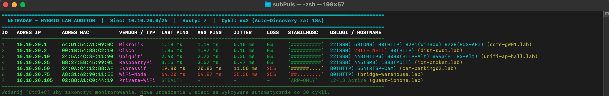

# 📡 netradar

-success.svg?style=flat-square)

**A lightweight, multi-threaded LAN auditor and real-time latency/jitter radar written in pure C++17 using low-level POSIX sockets.**

`netradar` discovers active devices across local subnets without requiring `sudo` privileges, profiles open administrative ports, normalizes MAC addresses with OUI vendor lookup, and continuously tracks RTT, Jitter, and Packet Loss in a live ANSI terminal dashboard.

---

## 📸 Live Terminal Preview

### Lab Environment Output Example (`10.10.20.0/24`)

    ===============================================================================================================================
      NETRADAR - HYBRID LAN AUDITOR  |  Siec: 10.10.20.0/24  |  Hosty: 6  |  Cykl: #42 (Auto-Discovery za: 18s)
    ===============================================================================================================================
    ID   ADRES IP       ADRES MAC          VENDOR / TYP  LAST PING   AVG PING    JITTER     LOSS   STABILNOSC    USLUGI / HOSTNAME
    -------------------------------------------------------------------------------------------------------------------------------
    1    10.10.20.1     64:D1:54:A1:09:BC  MikroTik      1.12 ms     1.18 ms     0.14 ms    0%     [##########]  22(SSH) 53(DNS) 80(HTTP) 8291(WinBox) 8728(ROS-API) (core-gw01.lab)
    2    10.10.20.2     00:1B:54:88:C2:10  Cisco         1.85 ms     1.92 ms     0.22 ms    0%     [##########]  22(SSH) 23(TELNET!) 80(HTTP) (dist-sw01.lab)
    3    10.10.20.10    24:5A:4C:3F:11:90  Ubiquiti      2.40 ms     2.65 ms     0.48 ms    0%     [##########]  22(SSH) 443(HTTPS) 8080(HTTP-Alt) 8443(HTTPS-Alt) (unifi-ap-hall.lab)
    4    10.10.20.25    B8:27:EB:45:99:01  RaspberryPi   3.10 ms     3.45 ms     0.85 ms    0%     [##########]  22(SSH) 1883(MQTT) (iot-broker.lab)
    5    10.10.20.50    24:0A:C4:12:88:AF  Espressif     18.40 ms    24.10 ms    8.90 ms    10%    [#######...]  80(HTTP) 554(RTSP-Cam) (cam-parking02.lab)
    6    10.10.20.105   02:88:A1:C0:44:19  Private-WiFi  STEALTH     -           -          -      [ARP-ONLY]    L2/L3 Active (guest-device.lab)
    -------------------------------------------------------------------------------------------------------------------------------
    Wcisnij [Ctrl+C] aby zakonczyc monitorowanie. Nowe urzadzenia w sieci sa wykrywane automatycznie co 30 cykli.

---

## ✨ Key Features

* **Hybrid Host Discovery (ARP + ICMP + TCP) without `sudo`:** Combines non-blocking TCP SYN probes, rootless `SOCK_DGRAM` ICMP Echo packets, and kernel ARP table synchronization to detect both open-port servers and stealth/firewalled devices (iOS, Android, Windows).
* **Automatic CIDR Subnet Detection:** Queries active network interfaces via `getifaddrs()` to calculate network boundaries automatically, with manual support for any CIDR range from `/20` to `/32`.
* **Real-Time Jitter & Packet Loss Telemetry:** Maintains a fixed-size circular buffer (`std::deque`) per host to compute rolling average latency, packet jitter, and loss percentage with O(1) memory overhead.
* **MAC Normalization & OUI Lookup:** Formats macOS ARP output into standard IEEE 802 notation, identifies hardware vendors (MikroTik, Ubiquiti, Cisco, Apple, RaspberryPi, Espressif), and flags Locally Administered Addresses (`Private-WiFi`).
* **Seamless Background Topology Refresh:** Periodically scans for newly connected devices every 30 cycles without wiping existing RTT/Jitter history.
* **16-Port Service Profiler:** Audits common network and administrative services (`21 FTP`, `22 SSH`, `23 Telnet`, `53 DNS`, `80 HTTP`, `443 HTTPS`, `445 SMB`, `554 RTSP`, `1883 MQTT`, `3389 RDP`, `8080/8443 HTTP-Alt`, `8291 WinBox`, `8728 RouterOS API`, `9100 JetDirect`, `62078 Apple Sync`).

---

## 🏗️ Modular Architecture

    netradar/
    ├── include/
    │   ├── HostStats.hpp       # Thread-safe host telemetry & circular RTT buffer
    │   ├── NetworkProber.hpp   # Non-blocking TCP, ICMP DGRAM, ARP & DNS wrappers
    │   ├── ScanEngine.hpp      # Multi-threaded CIDR scanner with descriptor batching
    │   ├── MacVendor.hpp       # MAC address normalization & OUI / LAA lookup
    │   └── DashboardTUI.hpp    # Zero-dependency ANSI escape sequence renderer
    ├── src/                    # Core C++17 implementation files (.cpp)
    ├── tests/                  # Unit tests for network math, MAC parsing & CIDR detection
    └── CMakeLists.txt          # CMake build configuration

### Technical Highlights
* **File Descriptor Batching:** Concurrent probes are dispatched in batches of 128 tasks via `std::async` to prevent hitting macOS `ulimit -n` socket exhaustion on larger subnets.
* **Non-Blocking Socket Engine:** Uses `fcntl(O_NONBLOCK)` paired with `poll()` and `getsockopt(SO_ERROR)` to distinguish between open ports (`SYN-ACK`), closed ports (`RST`), and filtered hosts (`DROP`) within milliseconds.
* **Bitwise CIDR Calculator:** Converts IPv4 addresses into 32-bit network-byte-order integers (`ntohl`/`htonl`) to compute subnet masks and host ranges dynamically.

---

## 🚀 Quick Start

### 1. Direct Compilation with `clang++` (macOS / Linux)

    git clone https://github.com/CallMeBazan/netradar.git
    cd netradar
    clang++ -std=c++17 -O2 -Iinclude src/*.cpp -o netradar
    ./netradar

### 2. Build with CMake (Optional)

    cmake -B build && cmake --build build
    ./build/netradar

### 3. CLI Usage Examples

    # Auto-detect local interface and subnet mask
    ./netradar

    # Audit a specific CIDR subnet (/20 to /32)
    ./netradar 192.168.88.0/24

    # Continuous jitter monitoring for a single target host
    ./netradar 192.168.1.1/32

### 4. Run Unit Tests

    clang++ -std=c++17 -Iinclude src/HostStats.cpp src/NetworkProber.cpp src/MacVendor.cpp tests/test_stats.cpp -o run_tests
    ./run_tests

---

## 🗺️ Roadmap

- [ ] Export session audit results to Markdown / JSON / CSV (`--export`)
- [ ] Layer 2 anomaly alerts (duplicate MAC / ARP spoofing detection)
- [ ] Custom fixed-size `ThreadPool` replacing `std::async`
- [ ] Passive discovery listener (`libpcap`) for CDP / LLDP / MNDP frames
